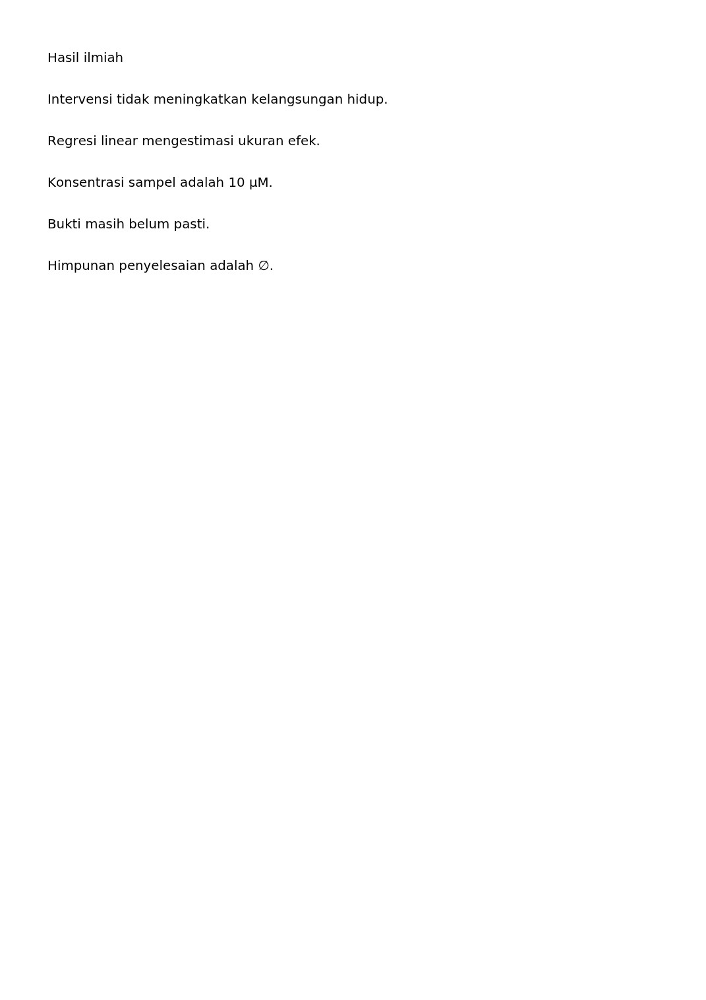

# CP18 SYNTHETIC FIXTURE: Indonesian scientific prose — Ekstraksi Sumber

**Berkas sumber:** digital-id.pdf
**Halaman:** 1
**Bahasa:** id → en
**Status:** Pemrosesan selesai; perlu peninjauan ilmiah 
**Bagian:** 6 diterjemahkan; 0 dipertahankan sengaja; 0 ditolak; 0 gagal; 0 belum diproses. Total 6.
**Rilis eksportir:** cp19-6ed0d134e1770b27 · 0.19.0.
**Metode:** ekstraksi PDF/OCR dan terjemahan mesin lokal. Tidak ada klaim verifikasi semantik menyeluruh.

**SHA-256 PDF sumber:** a7c157ec36f43aa7afbb4859c538dfe0e2517796172964866d55696ae13853b0

**Judul metadata PDF:** CP18 SYNTHETIC FIXTURE: Indonesian scientific prose

**Penulis metadata PDF:** Semantik Setara regression fixtures \(CC0\)

PDF asli dan aset visual yang tersedia disertakan dalam paket ini.

## Halaman 1

<!-- bagian: p0001-b0001 | halaman: 1 -->

Hasil ilmiah

<!-- bagian: p0001-b0002 | halaman: 1 -->

Intervensi tidak meningkatkan kelangsungan hidup.

<!-- bagian: p0001-b0003 | halaman: 1 -->

Regresi linear mengestimasi ukuran efek.

<!-- bagian: p0001-b0004 | halaman: 1 -->

Konsentrasi sampel adalah 10 μM.

<!-- bagian: p0001-b0005 | halaman: 1 -->

Bukti masih belum pasti.

<!-- bagian: p0001-b0006 | halaman: 1 -->

Himpunan penyelesaian adalah $\varnothing$.

#### Citra sumber — halaman 1

---

Dibuat dengan Semantik Setara — Academic PDF Translator. Teks sumber, hasil mesin, dan koreksi pengguna dipisahkan secara eksplisit.
