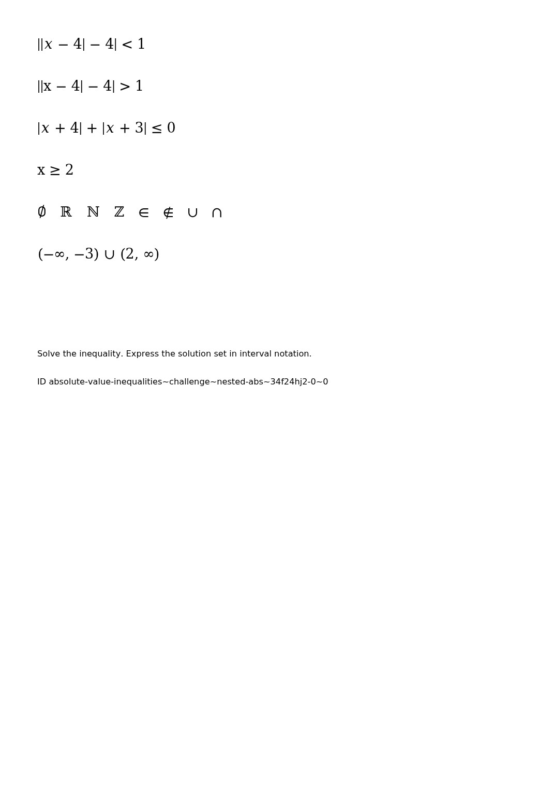

# CP18 SYNTHETIC FIXTURE: Inequality notation and mathematical identifiers — Sumber & Terjemahan

**Berkas sumber:** mathematics.pdf
**Halaman:** 1
**Bahasa:** en → id
**Status:** Pemrosesan selesai; perlu peninjauan ilmiah 
**Bagian:** 1 diterjemahkan; 7 dipertahankan sengaja; 0 ditolak; 0 gagal; 0 belum diproses. Total 8.
**Rilis eksportir:** cp19-6ed0d134e1770b27 · 0.19.0.
**Metode:** ekstraksi PDF/OCR dan terjemahan mesin lokal. Tidak ada klaim verifikasi semantik menyeluruh.

**SHA-256 PDF sumber:** 2a899abe5d8ff992f432ff04df1b7095b2300c253bddd94b32c900ed06a21575

**Judul metadata PDF:** CP18 SYNTHETIC FIXTURE: Inequality notation and mathematical identifiers

**Penulis metadata PDF:** Semantik Setara regression fixtures \(CC0\)

PDF asli dan aset visual yang tersedia disertakan dalam paket ini.

## Halaman 1

<!-- bagian: p1-math-1 | halaman: 1 -->

**Sumber**

$$
||x - 4| - 4| < 1
$$

**Terjemahan / hasil**

$$
||x - 4| - 4| < 1
$$

<!-- bagian: p1-math-2 | halaman: 1 -->

**Sumber**

$$
||x - 4| - 4| > 1
$$

**Terjemahan / hasil**

$$
||x - 4| - 4| > 1
$$

<!-- bagian: p1-math-3 | halaman: 1 -->

**Sumber**

$$
|x + 4| + |x + 3| \le 0
$$

**Terjemahan / hasil**

$$
|x + 4| + |x + 3| \le 0
$$

<!-- bagian: p1-math-4 | halaman: 1 -->

**Sumber**

$$
x \ge 2
$$

**Terjemahan / hasil**

$$
x \ge 2
$$

<!-- bagian: p1-math-5 | halaman: 1 -->

**Sumber**

$$
\varnothing \mathbb{R} \mathbb{N} \mathbb{Z} \in \notin \cup \cap
$$

**Terjemahan / hasil**

$$
\varnothing \mathbb{R} \mathbb{N} \mathbb{Z} \in \notin \cup \cap
$$

<!-- bagian: p1-math-6 | halaman: 1 -->

**Sumber**

$$
(-\infty , -3) \cup (2, \infty )
$$

**Terjemahan / hasil**

$$
(-\infty , -3) \cup (2, \infty )
$$

<!-- bagian: p0001-b0001 | halaman: 1 -->

**Sumber**

Solve the inequality. Express the solution set in interval notation.

**Terjemahan / hasil**

Selesaikan pertidaksamaan. Nyatakan himpunan penyelesaian dalam notasi interval.

<!-- bagian: p0001-b0002 | halaman: 1 -->

**Sumber**

ID absolute-value-inequalities\~challenge\~nested-abs\~34f24hj2-0\~0

**Terjemahan / hasil**

ID absolute-value-inequalities\~challenge\~nested-abs\~34f24hj2-0\~0

#### Citra sumber — halaman 1

---

Dibuat dengan Semantik Setara — Academic PDF Translator. Teks sumber, hasil mesin, dan koreksi pengguna dipisahkan secara eksplisit.
