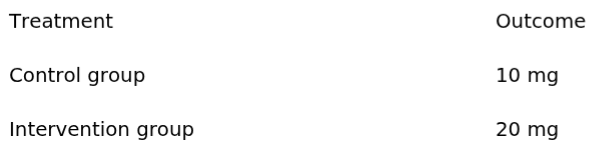
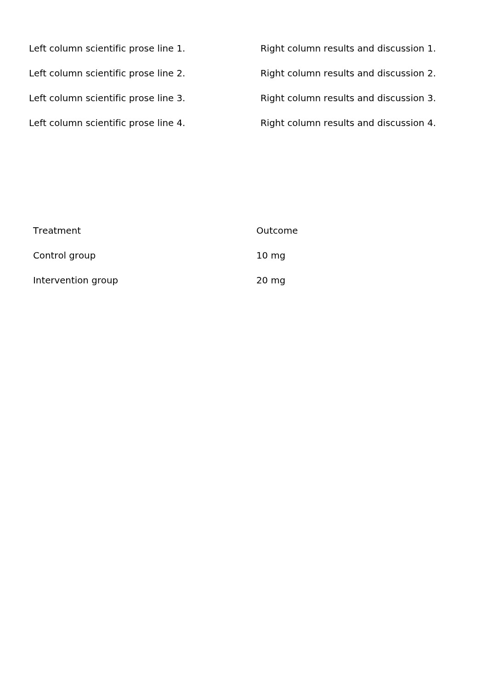

# CP18 SYNTHETIC FIXTURE: Tables and two columns — Ekstraksi Sumber

**Berkas sumber:** table-two-column.pdf
**Halaman:** 1
**Bahasa:** en → id
**Status:** Pemrosesan selesai; perlu peninjauan ilmiah 
**Bagian:** 9 diterjemahkan; 0 dipertahankan sengaja; 0 ditolak; 0 gagal; 0 belum diproses. Total 9.
**Rilis eksportir:** cp19-6ed0d134e1770b27 · 0.19.0.
**Metode:** ekstraksi PDF/OCR dan terjemahan mesin lokal. Tidak ada klaim verifikasi semantik menyeluruh.

**SHA-256 PDF sumber:** 29b42ba9519f75a28cf86e4e80cb1a3fbc539f31d441b03a1af2b66e06ad322b

**Judul metadata PDF:** CP18 SYNTHETIC FIXTURE: Tables and two columns

**Penulis metadata PDF:** Semantik Setara regression fixtures \(CC0\)

PDF asli dan aset visual yang tersedia disertakan dalam paket ini.

## Halaman 1

<!-- bagian: p0001-b0001 | halaman: 1 -->

Left column scientific prose line 1.

<!-- bagian: p0001-b0002 | halaman: 1 -->

Left column scientific prose line 2.

<!-- bagian: p0001-b0003 | halaman: 1 -->

Left column scientific prose line 3.

<!-- bagian: p0001-b0004 | halaman: 1 -->

Left column scientific prose line 4.

<!-- bagian: p0001-b0005 | halaman: 1 -->

Right column results and discussion 1.

<!-- bagian: p0001-b0006 | halaman: 1 -->

Right column results and discussion 2.

<!-- bagian: p0001-b0007 | halaman: 1 -->

Right column results and discussion 3.

<!-- bagian: p0001-b0008 | halaman: 1 -->

Right column results and discussion 4.

<!-- bagian: p0001-b0009 | halaman: 1 -->

| Treatment | Outcome |
| --- | --- |
| Control group | 10 mg |
| Intervention group | 20 mg |

#### Citra sumber — halaman 1

## Catatan pembacaan

- Halaman 1: Layout dua kolom terdeteksi. Periksa urutan baca di pratinjau.

---

Dibuat dengan Semantik Setara — Academic PDF Translator. Teks sumber, hasil mesin, dan koreksi pengguna dipisahkan secara eksplisit.
